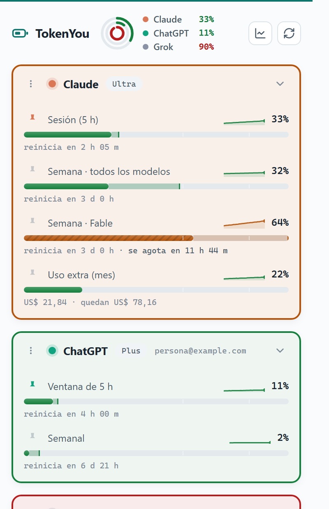

<div align="center">

# TokenYou 🔋

**Todos tus límites de uso de IA en un solo lugar. Privada de forma verificable.**

[](LICENSE)
[](manifest.json)
[](#el-modelo-de-seguridad)
[](package.json)
[](test/)

[Sitio](https://getescriba.com/tokenyou) · [Privacidad](PRIVACY.md) · [English](README.md) · **Español**



</div>

---

TokenYou es una extensión de Chrome (MV3) que muestra cuánto consumiste de tus límites de uso en siete plataformas de IA — ventanas de sesión, topes semanales, búsquedas restantes — con cuenta regresiva de cada reinicio, proyección de consumo y un badge en el ícono que sigue tu medidor más crítico.

Existe porque esta categoría tiene un problema de confianza: los medidores de uso conviven con tus conversaciones de IA y tus sesiones autenticadas, y la mayoría son de código cerrado, piden permisos de más, o las dos cosas. **TokenYou está hecha para que no tengas que confiar en ella.**

## El modelo de seguridad

| | Medidor típico | TokenYou |
|---|---|---|
| Acceso inicial a sitios | Todos los sitios, a veces `<all_urls>` | **Ninguno** — cada plataforma es un permiso opcional que activás una por una |
| Permiso de cookies | Suele pedirse | **Nunca** — las peticiones son del mismo origen; el navegador adjunta tu sesión y la extensión no puede leerla |
| Qué lee | Intercepción de red / scraping del DOM | **Solo el endpoint de uso de la plataforma** (números y horas de reinicio) |
| Tus conversaciones | Visibles para la extensión | **Nunca se tocan** |
| Telemetría | Analítica, heartbeats | **Cero tráfico de red** salvo a las plataformas que activaste |
| Tus datos | En sus servidores | **En tu navegador**, exportables en JSON o CSV, borrables con un clic |
| Código | Cerrado | MIT, este repo, **build reproducible** (`git archive`, hash publicado por release) |

Permisos del manifiesto, completos: `storage` y `alarms`. Nada más. El de notificaciones es opcional y solo se pide si activás los avisos.

### Una garantía: ningún código en ninguna página

Para todas las plataformas, TokenYou ofrece la misma garantía fuerte: **incapacidad arquitectónica**. Ningún código nuestro corre nunca dentro de la página de ningún sitio. La extensión solo hace peticiones en segundo plano al endpoint de uso de cada plataforma y lee los números de cuota. *No puede* ver tus conversaciones ni en principio, porque jamás está donde ellas están.

Y el invariante que va encima: **no hay vía de exfiltración**. TokenYou no tiene servidores y no hace ninguna petición de red salvo a las plataformas que activaste, así que ningún dato puede salir de tu navegador.

## Plataformas

| Plataforma | Señal | Origen |
|---|---|---|
| **Claude** (claude.ai) | Sesión + semanal + por modelo, gasto de uso extra, horas de reinicio. Comparte pool con Claude Code | `GET /api/organizations/{org}/usage` |
| **ChatGPT** (chatgpt.com) | Ventana de 5 h + semanal (mensual en gratuito), reinicios, plan | `GET /backend-api/wham/usage` |
| **Gemini** (gemini.google.com) | Uso de cómputo actual (5 h) y semanal, reinicios | RPC `jSf9Qc` de Boq vía `batchexecute` |
| **Grok** (grok.com) | Pool semanal de créditos, desglosado por producto, reinicio | gRPC-Web `GetGrokCreditsConfig` |
| **Perplexity** | Búsquedas Pro / Research / Labs / agénticas restantes | `GET /rest/rate-limit/all` |
| **GitHub Copilot** (github.com) | Solicitudes premium usadas del cupo mensual | `GET /settings/billing/copilot_usage_card` |
| **Abacus ChatLLM** (apps.abacus.ai) | Puntos de cómputo restantes y próximo reinicio | `GET /api/_getOrganizationComputePoints` |

Son los endpoints internos de cada plataforma — los mismos datos que muestran sus propias webs. No están documentados y pueden cambiar; cada adaptador está aislado, así que un cambio rompe solo esa plataforma (queda "no disponible") y el resto sigue andando. Las respuestas capturadas quedan fijadas como [fixtures de test](test/fixtures/), para que un cambio de API rompa un test en vez de mostrar un número equivocado.

> **Sobre los planes gratuitos.** ChatGPT free mide una ventana **mensual**, no semanal. Claude free no publica ningún dato de uso — TokenYou lo dice explícitamente en vez de reportar un error falso.

### Servicios personalizados (avanzado)

Página de opciones → definí servicios extra como JSON: un origin, una URL de uso en ese mismo host, y medidores mapeados con rutas de puntos sobre la respuesta (`pctPath`, o `usedPath`/`remainingPath` + `totalPath`, más un `resetPath` opcional). Viene una plantilla de Cursor como punto de partida (verificada por la comunidad; la forma de su endpoint puede necesitar ajustes — usá el botón Probar, que pide el permiso y muestra exactamente qué se leyó).

Los servicios personalizados siguen las mismas reglas que los nativos: solo https, el host del endpoint tiene que coincidir con el origin concedido, se activan por sitio desde el popup y se revocan cuando quieras. Para que un origin definido por vos pueda concederse en caliente, el manifiesto declara `https://*/*` en `optional_host_permissions` — eso **no concede nada** por sí solo; cada origin sigue necesitando su diálogo de permiso explícito.

## Qué más hace

**Proyección de consumo.** Cada medidor proyecta, en su propia barra, a dónde llegás cuando la ventana reinicie — y avisa si te agotás antes. Si activás las notificaciones, te lo dice *antes* de que pase: *«a este ritmo se agota antes del reinicio (jue 18:30)»*. La proyección es deliberadamente conservadora: sin ventana, sin historial suficiente o sin consumo, no hay proyección — un número inventado es peor que ninguno.

**Historial de uso.** Sparkline de 24 h en cada medidor, mapa de calor de 31 días, y comparación de ritmo contra la ventana anterior a la misma altura: *«vas 18% más rápido que la semana pasada»*.

**Tus datos son tuyos.** Todo vive en `chrome.storage.local`. Lo exportás en JSON o CSV desde opciones, o lo borrás, cuando quieras. Sin cuenta, sin sincronización, sin servidores.

**Control por plataforma.** El panel Plataformas es el lugar único para elegir qué ves: activar, mostrar/ocultar, frecuencia de refresco, quitar. Las plataformas ocultas se siguen midiendo para el historial pero no aparecen en el popup ni cuentan para el badge, así el popup queda exactamente tan chico como vos quieras.

**Accesibilidad.** El estado viaja por cuatro canales, no solo por color: tono, textura de la barra (lisa → rayada a medida que se acerca al límite), las marcas de 60% y 85% del riel, y `role="progressbar"` con el estado en palabras para los lectores de pantalla.

## Eficiencia

- Service worker MV3 orientado a eventos: una `chrome.alarms` por plataforma, con la frecuencia que elijas. Sin bucle de sondeo residente — entre refrescos la extensión duerme.
- JavaScript a secas con tipos en JSDoc. Sin frameworks, sin dependencias en tiempo de ejecución, sin paso de build: lo que leés en `src/` es exactamente lo que corre.
- El historial se guarda en dos resoluciones — detalle completo 24 h, una muestra por hora más atrás — así un mes de datos de todos los medidores cuesta unos cientos de KB.

## Instalar (desarrollo)

1. Cloná este repo.
2. Abrí `chrome://extensions` y activá el **modo de desarrollador**.
3. **Cargar descomprimida** → elegí la carpeta del repo.
4. Hacé clic en el ícono de TokenYou y activá las plataformas que uses.

## Verificar una release

Las releases se empaquetan con `git archive` desde un commit etiquetado, así que el zip es reproducible byte a byte:

```sh
git archive --format=zip -o tokenyou.zip <tag> manifest.json src icons _locales LICENSE
sha256sum tokenyou.zip   # comparar con el hash publicado en la release
```

## Contribuir

Los adaptadores viven en [src/adapters/](src/adapters/) — un archivo por plataforma, que devuelve el snapshot normalizado definido en [src/lib/quota.js](src/lib/quota.js). Dejá el parseo en una función pura exportada y sumá una respuesta capturada en [test/fixtures/](test/fixtures/); así, cuando una plataforma cambie su API, se rompe un test en vez de aparecer un número equivocado en la pantalla de alguien.

Los PR que agreguen plataformas son bienvenidos siempre que respeten el modelo de seguridad: solo endpoints de uso, nada de datos de conversaciones, ningún permiso nuevo más allá de un host opcional.

```sh
npm install
npm run typecheck
npm test
```

Disponible en inglés, español y portugués de Brasil — las traducciones están en [_locales/](_locales/) y un test mantiene los catálogos sincronizados.

## Licencia

[MIT](LICENSE) — © 2026 Diego Parras y quienes contribuyen a TokenYou.

*Política de privacidad: [PRIVACY.md](PRIVACY.md). TokenYou es un monitor de solo lectura de tu propia cuota. No elude, ni va a eludir, ningún límite de ninguna plataforma. Parte del [Ecosistema Escriba](https://getescriba.com).*
