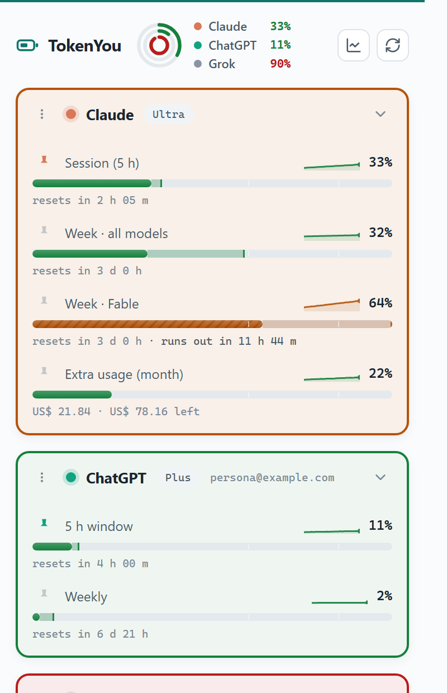

<div align="center">

# TokenYou 🔋

**All your AI usage limits in one place. Verifiably private.**

[](LICENSE)
[](manifest.json)
[](#the-security-model)
[](package.json)
[](test/)

[Website](https://getescriba.com/tokenyou) · [Privacy](PRIVACY.md) · **English** · [Español](README.es.md)



</div>

---

TokenYou is a Chrome (MV3) extension that shows how much of your usage limits you have consumed across seven AI platforms — session windows, weekly caps, remaining searches — with reset countdowns, consumption forecasts, and a toolbar badge tracking your most critical meter.

It exists because this category has a trust problem: usage trackers run next to your AI conversations and your authenticated sessions, and most of them are closed-source, over-permissioned, or both. **TokenYou is designed so you don't have to trust it.**

## The security model

| | Typical tracker | TokenYou |
|---|---|---|
| Default site access | All target sites, sometimes `<all_urls>` | **None** — each platform is an optional permission you grant one by one |
| Cookies permission | Often requested | **Never** — same-origin fetches let the browser attach the session; the extension can't read it |
| What it reads | Network interception / DOM scraping | **Only the platform's usage endpoint** (numbers and reset times) |
| Your conversations | Visible to the extension | **Never touched** |
| Telemetry | Analytics, heartbeats | **Zero network traffic** except to platforms you enabled |
| Your data | On their servers | **In your browser**, exportable as JSON or CSV, erasable in one click |
| Code | Closed | MIT, this repo, **reproducible build** (`git archive`, hash published per release) |

Manifest permissions, in full: `storage`, `alarms`. That's it. Notifications are optional and only requested if you turn alerts on.

### One guarantee: no code on any page

For every platform, TokenYou offers the same strong guarantee — **architectural incapability**. No code of ours ever runs inside any site's page. The extension only makes background fetches to each platform's usage endpoint and reads the quota numbers back. It *cannot* see your conversations even in principle, because it is never present where they are.

And the invariant on top of that: **there is no exfiltration path**. TokenYou has no servers and makes no network requests except to the platforms you enabled, so no data can leave your browser.

## Platforms

| Platform | Signal | Source |
|---|---|---|
| **Claude** (claude.ai) | Session + weekly + per-model %, extra usage spending, reset times. Shared pool with Claude Code | `GET /api/organizations/{org}/usage` |
| **ChatGPT** (chatgpt.com) | 5-hour + weekly window % (monthly on free), reset times, plan | `GET /backend-api/wham/usage` |
| **Gemini** (gemini.google.com) | Current (5 h) + weekly compute usage %, reset times | Boq `jSf9Qc` RPC via `batchexecute` |
| **Grok** (grok.com) | Weekly credit pool %, broken down by product, reset time | gRPC-Web `GetGrokCreditsConfig` |
| **Perplexity** | Remaining Pro / Research / Labs / Agentic searches | `GET /rest/rate-limit/all` |
| **GitHub Copilot** (github.com) | Premium requests used of monthly entitlement | `GET /settings/billing/copilot_usage_card` |
| **Abacus ChatLLM** (apps.abacus.ai) | Compute points remaining, next billing reset | `GET /api/_getOrganizationComputePoints` |

These are the platforms' own internal endpoints — the same data their web apps display. They are undocumented and can change; each adapter is isolated, so a breaking change degrades that one platform to "unavailable" while the rest keep working. Captured responses are pinned as [test fixtures](test/fixtures/) so API drift fails a test instead of silently showing a wrong number.

> **On free plans.** ChatGPT free measures a **monthly** window, not weekly. Claude free publishes no usage data at all — TokenYou says so explicitly rather than reporting a fake error.

### Custom services (advanced)

Options page → define additional services as JSON: an origin, a usage URL on that host, and meters mapped with dot-paths into the JSON response (`pctPath`, or `usedPath`/`remainingPath` + `totalPath`, plus optional `resetPath`). A Cursor template ships as a starting point (community-verified — its endpoint shape may need adjusting; use the Test button, which requests the permission and shows exactly what was read).

Custom services follow the same rules as built-ins: https only, endpoint host must match the granted origin, enabled per-site from the popup, revocable anytime. To make user-defined origins grantable at runtime, the manifest declares `https://*/*` under `optional_host_permissions` — this grants **nothing** by itself; every origin still requires an explicit per-site permission dialog.

## What else it does

**Consumption forecast.** Each meter projects, on its own bar, where you land when the window resets — and warns when you'd run out first. If you enable notifications, it tells you *before* it happens: *"at this rate it runs out before the reset (Thu 18:30)."* The projection is deliberately conservative: no window, not enough history, or no consumption means no forecast at all, because a made-up number is worse than none.

**Usage history.** 24 h sparkline on every meter, a 31-day activity heatmap, and a pace comparison against the previous window at the same point in its life — *"you're going 18% faster than last week."*

**Your data stays yours.** Everything lives in `chrome.storage.local`. Export it as JSON or CSV from the options page, or clear it, whenever you want. No account, no sync, no servers.

**Per-platform control.** The Platforms panel is the single place to choose what you see: enable, show/hide, refresh frequency, revoke. Hidden platforms keep measuring for history but stay out of the popup and the badge, so the popup stays exactly as small as you want it.

**Accessibility.** State travels through four channels, not just color: hue, bar texture (smooth → striped as you approach the limit), the 60%/85% marks on the rail, and `role="progressbar"` with the state spelled out for screen readers.

## Efficiency

- Event-driven MV3 service worker: one `chrome.alarms` per platform at your chosen frequency. No resident polling loop — the extension sleeps between refreshes.
- Vanilla JavaScript with JSDoc types. No frameworks, no runtime dependencies, no build step: what you read in `src/` is exactly what runs.
- History is stored at two resolutions — full detail for 24 h, one sample per hour beyond that — so a month of data for every meter costs a few hundred KB.

## Install (development)

1. Clone this repo.
2. Open `chrome://extensions`, enable **Developer mode**.
3. **Load unpacked** → select the repo folder.
4. Click the TokenYou icon and enable the platforms you use.

## Verify a release

Releases are packed with `git archive` from a tagged commit, so the zip is byte-reproducible:

```sh
git archive --format=zip -o tokenyou.zip <tag> manifest.json src icons _locales LICENSE
sha256sum tokenyou.zip   # compare with the hash published in the release
```

## Contributing

Adapters live in [src/adapters/](src/adapters/) — one file per platform, returning the normalized snapshot defined in [src/lib/quota.js](src/lib/quota.js). Keep the parsing in a pure exported function and ship a captured response under [test/fixtures/](test/fixtures/); that is how a platform changing its API becomes a failing test instead of a wrong number on someone's screen.

PRs adding platforms are welcome as long as they respect the security model: usage endpoints only, no conversation data, no new permissions beyond an optional host.

```sh
npm install
npm run typecheck
npm test
```

Available in English, Spanish and Brazilian Portuguese — translations live in [_locales/](_locales/) and a test keeps the catalogs in sync.

## License

[MIT](LICENSE) — © 2026 Diego Parras and TokenYou contributors.

*Privacy policy: [PRIVACY.md](PRIVACY.md). TokenYou is a read-only monitor of your own quota. It does not and will not help bypass platform limits. Part of the [Escriba ecosystem](https://getescriba.com).*
